<p align="center">
  
</p>

<p align="center">
  <b>Agent skills that make coding agents careful with tumor-immune data.</b><br />
  Decision rules with checked sources · standard-library scripts with unit tests · evals for every skill
</p>

<p align="center">
  <a href="https://github.com/Alex-w0731/tumor-immunology-skills/actions/workflows/ci.yml"></a>
  <a href="https://github.com/Alex-w0731/tumor-immunology-skills/actions/workflows/citations.yml"></a>
  <a href="https://agentskills.io/specification"></a>
  
  <a href="LICENSE"></a>
</p>

<p align="center">
  <a href="README.zh-CN.md">中文说明</a> ·
  <a href="#skills">Skills</a> ·
  <a href="#install">Install</a> ·
  <a href="docs/verification.md">How it is verified</a> ·
  <a href="docs/authoring.md">Authoring guide</a>
</p>

---

## Why this exists

A capable coding agent already knows what a Cox model, a UMAP or a deconvolution method is. What goes wrong in tumor immunology is the judgment around them. Left alone, an agent will happily:

- treat 30,000 cells from six patients as thirty thousand independent observations;
- pick the survival cut-point that gives the smallest p-value;
- compare repertoire richness between samples sequenced at different depths;
- read an enrichment score as a cell fraction;
- attach a real citation to a threshold the paper never reported.

Each skill in this repository carries the rule, the reason for it, a tested script for the calculation, and the primary source, so that both the agent and you can check the work. They are written for research use and stay with analysis, statistics, interpretation and reporting.

## What changes with a skill

From the first blind comparison: one eval case per skill, the same model with and without the skill, graded by an agent that did not know which run was which. Details and caveats are in [docs/evals.md](docs/evals.md).

| Situation in the eval | Without the skill | With the skill |
|---|---|---|
| The "best" cut-off of a CD8 score gives log-rank p = 0.008 | Kept the outcome-selected split as the paper's only Kaplan-Meier figure | Median split as the figure (log-rank p = 0.17); the searched cut-off gets a search-adjusted p of about 0.13 and goes to a separate figure labelled exploratory |
| Cell-type shares before and on anti-PD-1 in 5 patients | Switched to a paired t-test that can reach P = 0.016 and led the results sentence with it | Exact signed-rank p = 0.0625, the smallest possible with 5 pairs, an effect of +8.1 percentage points, and a sentence labelled exploratory |
| TCR repertoire of one patient, 30 cells before and 80 after | Cell-level permutation tests (p = 0.004) and raw clonotype counts (37 versus 26) | No tests on a single patient; at equal cell numbers the post sample has fewer clonotypes (17 versus 26) |
| tmelens-style phenotypes for 12 tumours | Reported "4 to 6 of 12 inflamed (33-50%)" as an estimate with a confidence interval | 4 of 12 is fixed by the top-third rule, so it is not a prevalence; Pan_F_TBRS is dropped at 7 of 19 genes |
| A GMT file that defines the same set name twice | Renamed both sets without saying which one a reader would have kept | A reader keyed by set name silently keeps the last (3-gene) definition; kept the 8-gene set and logged why |

Across the nine cases, runs with the skill passed 48 of 48 graded statements and runs without passed 39 of 48, and the blind grader preferred the answer written with the skill in 9 of 9 cases. The model was already strong on its own: the skills earn their place at decision points like these.

<a name="skills"></a>

## Skills

<!-- catalog:start -->

**Profile the tumor immune microenvironment**

| Skill | What it makes the agent do | Bundled scripts |
|---|---|---|
| [`tme-bulk-profiling`](skills/tme-bulk-profiling/SKILL.md) | Checks a bulk tumor expression matrix, scores immune signatures and reports immune phenotypes with their limits. | `check_expression_matrix.py` `signature_coverage.py` |
| [`immune-deconvolution-review`](skills/immune-deconvolution-review/SKILL.md) | Chooses, runs and sanity-checks immune deconvolution of bulk tumor transcriptomes, with an NNLS script and a mixture benchmark. | `mixture_benchmark.py` `nnls_deconvolve.py` |
| [`immune-signature-curation`](skills/immune-signature-curation/SKILL.md) | Builds, imports and audits immune gene signatures and GMT files for provenance, symbol hygiene, redundancy and confounding. | `gmt_lint.py` `signature_overlap.py` |

**Single-cell, repertoire and spatial statistics**

| Skill | What it makes the agent do | Bundled scripts |
|---|---|---|
| [`single-cell-patient-level-stats`](skills/single-cell-patient-level-stats/SKILL.md) | Compares groups in single-cell data at the patient level: pseudobulk DE, composition tests, paired designs and few-patient limits. | `composition_test.py` `pseudobulk_aggregate.py` |
| [`tcr-repertoire-metrics`](skills/tcr-repertoire-metrics/SKILL.md) | Computes TCR repertoire diversity, clonality and overlap from clonotype counts, compared at equal sequencing depth. | `repertoire_metrics.py` `repertoire_overlap.py` |
| [`spatial-neighborhood-statistics`](skills/spatial-neighborhood-statistics/SKILL.md) | Tests cell-type co-localization and segregation in tissue by label permutation, per slide, with the patient as the replicate. | `neighborhood_enrichment.py` |

**Outcome and response**

| Skill | What it makes the agent do | Bundled scripts |
|---|---|---|
| [`immune-survival-analysis`](skills/immune-survival-analysis/SKILL.md) | Tests immune features against survival with continuous Cox models, sound endpoints, FDR and no cut-point fishing. | `cutpoint_inflation.py` `fdr_adjust.py` `km_logrank.py` |
| [`response-biomarker-evaluation`](skills/response-biomarker-evaluation/SKILL.md) | Tests whether a biomarker separates immunotherapy responders from non-responders, with honest uncertainty and leakage checks. | `roc_auc.py` `threshold_metrics.py` |

**Evidence**

| Skill | What it makes the agent do | Bundled scripts |
|---|---|---|
| [`citation-evidence-check`](skills/citation-evidence-check/SKILL.md) | Checks that references exist, match their metadata, are not retracted, and actually support the claims they are cited for. | `verify_references.py` |

<sub>9 skills, 17 scripts.</sub>

<!-- catalog:end -->

Every skill folder has the same shape:

```text
skills/<name>/
  SKILL.md              what to do, in what order, and why; defaults with source keys; pitfalls; report template
  references/
    sources.md          the bibliography: every key used in the skill, with DOI and PMID
    <topic>.md          detail that is loaded only when needed
  scripts/<tool>.py     Python standard library only, deterministic, documented formulas
  evals/<case>/         prompt, expected outcome and graders (the `claude plugin eval` layout)
tests/<name>/           unit tests for the scripts, with hand-derived expected values
```

<a name="install"></a>

## Install

**Claude Code, as a plugin**

```text
/plugin marketplace add Alex-w0731/tumor-immunology-skills
/plugin install tumor-immunology@tumor-immunology-skills
```

Skills load on their own when a request matches their description. To call one explicitly, type `/tumor-immunology:<skill-name>`. To update later: `/plugin marketplace update tumor-immunology-skills`.

**One skill, by hand**

```bash
git clone https://github.com/Alex-w0731/tumor-immunology-skills.git
mkdir -p ~/.claude/skills && cp -R tumor-immunology-skills/skills/immune-survival-analysis ~/.claude/skills/
```

Each skill is self-contained, so copying its folder is enough.

**Other agents**

The folders follow the open [Agent Skills](https://agentskills.io) format and use only its standard frontmatter fields (`name`, `description`, `license`, `compatibility`, `metadata`). Agents that implement the format can load them: copy a skill folder into the skills directory your agent reads. See the documentation for [Codex](https://developers.openai.com/codex/skills), [Cursor](https://cursor.com/docs/context/skills), [GitHub Copilot](https://docs.github.com/en/copilot/concepts/agents/about-agent-skills), [Gemini CLI](https://geminicli.com/docs/cli/skills/) and [OpenCode](https://opencode.ai/docs/skills).

**Run a script without any agent**

The scripts are ordinary command-line tools with no dependencies:

```bash
python3 skills/immune-survival-analysis/scripts/km_logrank.py --help
```

## How it is verified

| Layer | What is checked | Where |
|---|---|---|
| Sources | Every numeric threshold, definition and attributed claim carries a key that resolves in the skill's `references/sources.md`. A checker resolves every DOI and PMID at Crossref and PubMed and compares year, first author and title with the entry. | [`tools/check_citations.py`](tools/check_citations.py), run by a [workflow](.github/workflows/citations.yml) whenever a bibliography changes |
| Scripts | Standard library only, no network unless declared, `--help` runs, unit tests with expected values derived by hand or from published worked examples. | [`tools/run_tests.py`](tools/run_tests.py), CI on Python 3.10 to 3.14 (Linux, macOS, Windows) |
| Structure | Frontmatter, line budget, link targets, orphan files, eval layout, no machine-specific paths. | [`tools/validate_skills.py`](tools/validate_skills.py) |
| Review | Each skill was drafted by one AI agent and then audited by a second, independent one that re-read the cited sources, recomputed script outputs and repaired what it found. | [`docs/verification.md`](docs/verification.md) |
| Behaviour | Three eval cases per skill with objective graders, run with and without the skill. First blind run, one case per skill: 48/48 statements with the skill, 39/48 without. | [`docs/evals.md`](docs/evals.md), `skills/<name>/evals/` |

The machine checks catch references that do not exist or that point at a different paper. They cannot prove that a paper supports the sentence it is cited for; that depends on review, and review can miss things. [`docs/verification.md`](docs/verification.md) says plainly what has and has not been checked. If you find an error, please open an issue with the source: corrections are the most valuable contribution here.

## Scope and limits

- **Research use only.** Nothing here is clinical decision support.
- **Analysis side only.** Data analysis, statistics, interpretation and reporting. No wet-lab protocols.
- **Defaults, not laws.** Thresholds are given with their provenance and labelled as published, conventional or heuristic. Date-sensitive facts carry an "as of" stamp.
- **Synthetic examples are labelled synthetic** and are never presented as findings.

## Related

- [`tmelens`](https://github.com/Alex-w0731/tmelens): a transparent Python toolkit to profile the tumour immune microenvironment from bulk transcriptomes. Several skills here use it when it is installed and fall back to their own scripts when it is not.
- The [Agent Skills specification](https://agentskills.io/specification).

## Contributing

Corrections and new skills are welcome. Read [CONTRIBUTING.md](CONTRIBUTING.md) and the [authoring guide](docs/authoring.md) first: the bar is that a skill changes what an agent does, cites what it claims, and tests what it computes.

```bash
python3 tools/validate_skills.py     # structure, evidence keys, scripts, evals
python3 tools/run_tests.py           # unit tests of every bundled script
python3 tools/build_catalog.py       # refresh the catalog tables above
```

## Citation

If these skills contribute to your work, cite the repository (see [`CITATION.cff`](CITATION.cff)) together with the primary papers listed in the relevant skill's `references/sources.md`.

## License

[MIT](LICENSE) © Alex Wang
