<p align="center">
  
</p>

<p align="center">
  <b>让编程智能体在处理肿瘤免疫数据时足够严谨的一组技能（Agent Skills）。</b><br />
  有出处的判断规则 · 只依赖标准库并带单元测试的脚本 · 每个技能都有评测用例
</p>

<p align="center">
  <a href="https://github.com/Alex-w0731/tumor-immunology-skills/actions/workflows/ci.yml"></a>
  <a href="https://github.com/Alex-w0731/tumor-immunology-skills/actions/workflows/citations.yml"></a>
  <a href="https://agentskills.io/specification"></a>
  
  <a href="LICENSE"></a>
</p>

<p align="center">
  <a href="README.md">English</a> ·
  <a href="#skills">技能目录</a> ·
  <a href="#install">安装</a> ·
  <a href="docs/verification.md">如何验证</a> ·
  <a href="docs/authoring.md">编写规范</a>
</p>

---

## 为什么做这个

一个足够强的编程智能体本来就知道 Cox 模型、UMAP、反卷积是什么。它在肿瘤免疫分析里出错的地方，是围绕这些方法的判断。放任不管时，它会很自然地：

- 把 6 个患者的 3 万个细胞当成 3 万个独立样本；
- 挑一个让 p 值最小的生存分析截断值；
- 在测序深度不同的样本之间直接比较受体库丰富度；
- 把富集分数读成细胞比例；
- 给一个阈值配上一篇真实存在、但原文里根本没有这个阈值的文献。

本仓库的每个技能都写清楚规则、规则背后的原因、用来计算的已测试脚本，以及一手文献出处，让智能体和你都能核对。内容面向科研使用，只覆盖数据分析、统计、解读与报告。

<a name="skills"></a>

## 技能目录

<!-- catalog:start -->

**刻画肿瘤免疫微环境**

| 技能 | 它让智能体做对什么 | 附带脚本 |
|---|---|---|
| [`tme-bulk-profiling`](skills/tme-bulk-profiling/SKILL.md) | 检查肿瘤 bulk 表达矩阵，计算免疫特征评分，并在说明局限的前提下给出免疫表型。 | `check_expression_matrix.py` `signature_coverage.py` |
| [`immune-deconvolution-review`](skills/immune-deconvolution-review/SKILL.md) | 选择、运行并核查肿瘤 bulk 转录组的免疫去卷积，附 NNLS 脚本与混合样本基准评估。 | `mixture_benchmark.py` `nnls_deconvolve.py` |

**单细胞、受体库与空间统计**

| 技能 | 它让智能体做对什么 | 附带脚本 |
|---|---|---|
| [`single-cell-patient-level-stats`](skills/single-cell-patient-level-stats/SKILL.md) | 单细胞组间比较的患者水平统计：伪bulk差异表达、细胞比例检验、配对设计与小样本边界 | `composition_test.py` `pseudobulk_aggregate.py` |
| [`tcr-repertoire-metrics`](skills/tcr-repertoire-metrics/SKILL.md) | 基于克隆型计数表计算TCR库多样性、克隆性与样本间重叠，并在相同测序深度下比较。 | `repertoire_metrics.py` `repertoire_overlap.py` |

**生存结局与疗效**

| 技能 | 它让智能体做对什么 | 附带脚本 |
|---|---|---|
| [`immune-survival-analysis`](skills/immune-survival-analysis/SKILL.md) | 用连续Cox模型、合理终点与FDR检验免疫特征与生存的关联，不做截断值挖掘。 | `cutpoint_inflation.py` `fdr_adjust.py` `km_logrank.py` |
| [`response-biomarker-evaluation`](skills/response-biomarker-evaluation/SKILL.md) | 评估生物标志物能否区分免疫治疗应答者与非应答者，含不确定性与信息泄漏检查。 | `roc_auc.py` `threshold_metrics.py` |

<sub>共 6 个技能、13 个脚本。</sub>

<!-- catalog:end -->

每个技能目录结构一致：

```text
skills/<name>/
  SKILL.md              做什么、按什么顺序、为什么；带出处的默认值；常见错误；报告模板
  references/
    sources.md          参考文献：技能里用到的每个引用键，附 DOI 与 PMID
    <topic>.md          只在需要时加载的细节
  scripts/<tool>.py     仅用 Python 标准库，结果确定，公式有文档
  evals/<case>/         提示词、预期结果与评分项（`claude plugin eval` 的目录格式）
tests/<name>/           脚本的单元测试，期望值手工推导
```

<a name="install"></a>

## 安装

**Claude Code（插件方式）**

```text
/plugin marketplace add Alex-w0731/tumor-immunology-skills
/plugin install tumor-immunology@tumor-immunology-skills
```

请求与技能描述匹配时会自动加载；也可以输入 `/tumor-immunology:<技能名>` 显式调用。之后更新：`/plugin marketplace update tumor-immunology-skills`。

**只装某一个技能**

```bash
git clone https://github.com/Alex-w0731/tumor-immunology-skills.git
mkdir -p ~/.claude/skills && cp -R tumor-immunology-skills/skills/immune-survival-analysis ~/.claude/skills/
```

每个技能都是自包含的，复制它的文件夹即可。

**其他智能体**

目录遵循开放的 [Agent Skills](https://agentskills.io) 格式，只使用标准 frontmatter 字段（`name`、`description`、`license`、`compatibility`、`metadata`）。实现了该格式的智能体都可以加载：把技能文件夹复制到对应智能体读取的 skills 目录即可，具体见 [Codex](https://developers.openai.com/codex/skills)、[Cursor](https://cursor.com/docs/context/skills)、[GitHub Copilot](https://docs.github.com/en/copilot/concepts/agents/about-agent-skills)、[Gemini CLI](https://geminicli.com/docs/cli/skills/) 和 [OpenCode](https://opencode.ai/docs/skills) 的文档。

**不用智能体，直接跑脚本**

脚本就是没有任何依赖的普通命令行工具：

```bash
python3 skills/immune-survival-analysis/scripts/km_logrank.py --help
```

## 如何验证

| 层次 | 检查什么 | 在哪里 |
|---|---|---|
| 文献出处 | 每个数值阈值、定义和归因说法都带引用键，并能在该技能的 `references/sources.md` 中找到。核查工具会到 Crossref 和 PubMed 解析每个 DOI 与 PMID，并比对年份、第一作者和标题。 | [`tools/check_citations.py`](tools/check_citations.py)，参考文献一有改动就由[工作流](.github/workflows/citations.yml)运行 |
| 脚本 | 仅标准库；除非声明否则不联网；`--help` 可运行；单元测试的期望值由手工推导或取自已发表的算例。 | [`tools/run_tests.py`](tools/run_tests.py)，CI 覆盖 Python 3.9–3.13（Linux、macOS、Windows） |
| 结构 | frontmatter、行数预算、链接目标、孤立文件、评测目录格式、不含本机路径。 | [`tools/validate_skills.py`](tools/validate_skills.py) |
| 复核 | 每个技能先由一个 AI 智能体起草，再由另一个独立的智能体复核：重读所引文献、重新计算脚本输出，并修复发现的问题。 | [`docs/verification.md`](docs/verification.md) |
| 行为 | 每个技能三个评测用例，评分项客观，用于对比“有技能 / 无技能”两种情况。 | `skills/<name>/evals/` |

机器检查能发现不存在的文献，或指向了另一篇论文的标识符；但它无法证明某篇论文确实支持引用它的那句话，这要靠复核，而复核也可能遗漏。[`docs/verification.md`](docs/verification.md) 如实说明了哪些检查过、哪些没有。如果你发现错误，请带上出处提 issue：纠错是这里最有价值的贡献。

## 范围与限制

- **仅供科研使用。** 这里的任何内容都不是临床决策支持。
- **只做分析侧。** 数据分析、统计、解读与报告；不包含湿实验操作方案。
- **是默认值，不是定律。** 阈值都注明来源，并标注为“已发表”“惯例”或“经验法则”；有时效性的事实带有“截至某年某月”的标记。
- **合成示例都会标明是合成数据**，不会被当作研究发现呈现。

## 相关项目

- [`tmelens`](https://github.com/Alex-w0731/tmelens)：从 bulk 转录组刻画肿瘤免疫微环境的透明 Python 工具包。这里的部分技能在装有 tmelens 时会调用它，没有时退回到技能自带的脚本。
- [Agent Skills 规范](https://agentskills.io/specification)。

## 参与贡献

欢迎纠错和新增技能。请先阅读 [CONTRIBUTING.md](CONTRIBUTING.md) 和[编写规范](docs/authoring.md)：标准是技能确实会改变智能体的做法，说到的都有出处，算出来的都有测试。

```bash
python3 tools/validate_skills.py     # 结构、引用键、脚本、评测
python3 tools/run_tests.py           # 所有脚本的单元测试
python3 tools/build_catalog.py       # 刷新上面的目录表
```

## 引用

如果这些技能对你的工作有帮助，请引用本仓库（见 [`CITATION.cff`](CITATION.cff)），并同时引用相关技能 `references/sources.md` 中列出的一手文献。

## 许可

[MIT](LICENSE) © Alex Wang
